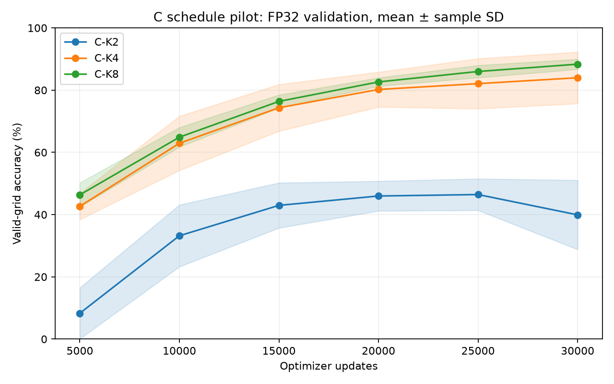

# Sudoku condition C schedule pilot

Report date: 23 October 2026. All 15 runs completed successfully.

This experiment compares condition C with two, four, and eight training states per example. At the fixed endpoint of **30,000 optimizer updates**, eight states reached **88.34% ± 1.63 percentage points**, compared with **83.98% ± 8.29** for four states and **39.92% ± 11.12** for two states. Eight states had the highest mean and lowest variation across the five seeds, with a mean gain of **4.36 percentage points** over four states.

These are FP32 validation results on 1,024 puzzles from the training holdout. The earlier A–F results used the supplied test set and a different update budget; this pilot does not establish an improvement over F. The [original condition C report](../sudoku_C/README.md) remains the reference for that comparison.

## Equal optimizer budgets

**Every variant used exactly 30,000 optimizer updates.** One update processes one batch of current states with one forward pass, one backward pass, and one optimizer step. A complete example reuse cycle takes two, four, or eight updates, depending on the variant; it is not counted as a single update.

| Variant | States per example | Nominal mask counts | Updates per run | Seeds | Global batch size |
|---|---:|---|---:|---:|---:|
| C-K2 | 2 | 81, 41 | 30,000 | 5 | 64 |
| C-K4 | 4 | 81, 61, 41, 21 | 30,000 | 5 | 64 |
| C-K8 | 8 | 81, 71, 61, 51, 41, 31, 21, 11 | 30,000 | 5 | 64 |

All variants therefore processed 1,920,000 example states per run. This does not mean equal numbers of fresh examples or equal supervised masked tokens. Longer cycles retain examples for more updates and include different mask counts. The comparison changes both example reuse duration and the mask-count distribution, so it cannot isolate the effect of reuse alone.

All three variants implement C: masks are independently resampled at every state, and previously visible target cells can become masked again. Givens stay visible; other visible cells contain ground-truth digits. Mask counts are scaled to each puzzle's empty cells, and batch slots have staggered stages.

## Training and evaluation settings

| Setting | Value shared across variants |
|---|---|
| Seeds | 1000, 2000, 3000, 4000, 5000; identical initial weights within each paired seed |
| Model | 8 Transformer layers, width 256, MLP width 768, 8 attention heads, vocabulary 11, sequence length 81 |
| Optimizer | AdamW, learning rate 0.0003, weight decay 0.01, gradient clipping 1.0 |
| Learning-rate schedule | 1,000 warmup updates; original cosine horizon of 53,570 updates, stopped at 30,000 |
| Training precision | BF16 mixed precision with FP32 parameters and optimizer states |
| EMA | Decay 0.9999 |
| Batch and hardware | 32 examples per GPU on two NVIDIA A100 40 GB GPUs; global batch 64 |
| Generation validation | The same 1,024 distinct puzzles from the original 5% training holdout; split seed 2026 |
| Evaluation precision | Full FP32 forward and softmax, TF32 disabled |
| Decoder | EMA weights, greedy `top_k_unmasking_1`, one predicted cell per decoding step, givens preserved |
| Evaluation frequency | Every 5,000 updates, giving six observations per run |

The validation selection excludes puzzles appearing in the training subset. Its manifest records zero puzzle overlap with training. The supplied test set was not used for pilot generation or schedule selection.

Accuracy is the fraction of generated grids that satisfy Sudoku constraints and preserve givens. The evaluator does not compare every generated cell to the stored solution. Random-mask validation loss uses the same 1,024 puzzles with non-EMA weights, inherited BF16 loss computation, and a fixed mask RNG. It is a separate diagnostic from FP32 generation accuracy.

## Final results across all seeds

Every value below comes from the final 30,000-update EMA checkpoint. Accuracy is in percent; sample SD uses `ddof=1` and is expressed in percentage points. No best-seed or best-checkpoint selection is applied.

| Seed | C-K2 accuracy | C-K4 accuracy | C-K8 accuracy |
|---|---:|---:|---:|
| 1000 | 54.30 | 86.43 | 87.79 |
| 2000 | 25.00 | 82.81 | 86.91 |
| 3000 | 43.65 | 91.60 | 91.11 |
| 4000 | 33.50 | 88.77 | 88.28 |
| 5000 | 43.16 | 70.31 | 87.60 |
| **Mean ± sample SD** | **39.92 ± 11.12** | **83.98 ± 8.29** | **88.34 ± 1.63** |

Eight states beat four states in three of the five paired seeds. The largest difference was for seed 5000; the small losses for seeds 3000 and 4000 show that the improvement was not uniform.

| Seed | C-K8 minus C-K4 in percentage points |
|---|---:|
| 1000 | +1.37 |
| 2000 | +4.10 |
| 3000 | -0.49 |
| 4000 | -0.49 |
| 5000 | +17.29 |
| **Mean paired difference ± sample SD** | **+4.36 ± 7.47** |

The paired SD describes variation in the seed-level differences. It is not a confidence interval or the SD of either condition alone. Five paired seeds support a promising observed mean gain, not a universal improvement.

## Learning curves

| Optimizer updates | C-K2 mean ± sample SD | C-K4 mean ± sample SD | C-K8 mean ± sample SD |
|---|---:|---:|---:|
| 5,000 | 8.30 ± 8.22 | 42.66 ± 4.24 | 46.37 ± 3.89 |
| 10,000 | 33.20 ± 9.94 | 62.93 ± 8.70 | 64.88 ± 3.13 |
| 15,000 | 42.97 ± 7.25 | 74.34 ± 7.52 | 76.39 ± 2.09 |
| 20,000 | 45.98 ± 4.78 | 80.21 ± 5.60 | 82.64 ± 1.34 |
| 25,000 | 46.45 ± 5.07 | 82.09 ± 8.05 | 86.00 ± 1.98 |
| 30,000 | 39.92 ± 11.12 | 83.98 ± 8.29 | 88.34 ± 1.63 |

The eight-state mean increased at every observed checkpoint. The two-state mean fell from 46.45% at 25,000 updates to 39.92% at 30,000. This decline occurred under full FP32 evaluation, so the previous BF16 evaluation mode is not an explanation for this observation. Its cause has not been isolated.

## Elapsed time

The values below are means over five seeds, in minutes. Training time is the recorded training timer, evaluation time sums the six recorded evaluations, and process time is elapsed time around the complete training subprocess. Queue waiting time is excluded. Process time also includes setup and other overhead.

| Variant | Training minutes | Evaluation minutes | Process minutes |
|---|---:|---:|---:|
| C-K2 | 18.54 | 1.49 | 20.26 |
| C-K4 | 18.47 | 1.35 | 20.05 |
| C-K8 | 18.48 | 1.31 | 20.02 |

Each run used two A100 GPUs. These are elapsed minutes per run, not GPU minutes. Runs executed on gpu-03 and gpu-08. The observed process times were similar across schedules.

## Files and plotting

| File or directory | Contents |
|---|---|
| `final_summary.csv`, `summary.json` | Final means and sample SDs for all three variants |
| `per_seed.csv` | Fifteen final results, validation losses, and recorded times |
| `curves.csv`, `aggregate_curves.csv` | Ninety individual evaluations and eighteen mean/SD observations |
| `paired.csv` | Per-seed differences for C-K2 and C-K8 against C-K4 |
| `plotting_history.csv` | Evaluation rows with the team's `eval_main/acc_top_k_unmasking_1` metric name |
| `learning_curves.png`, `timing_summary.csv` | Curve figure and mean elapsed times |
| `configs/` | Fifteen frozen experiment configurations |
| `run_records/` | Raw metrics, effective and launch configurations, run metadata, and completion records |
| `provenance/` | Experiment plan, data manifest, source hashes and snapshot, original protocol, and verification records |
| `FILES.sha256` | Checksums of all package files other than the checksum file itself |

For W&B plots, keep one run per `(variant, seed)`, use `optimizer_step` on the x-axis, and group by `variant`. `plotting_history.csv` stores accuracy as a fraction in [0, 1]; the summary CSVs use percent. Plot the five-seed mean with a standard-deviation band and retain individual seeds for inspection. Keep this pilot in its own experiment group because its validation set and budget differ from the original A–F comparison. No W&B upload is included in this report preparation.

## Provenance and next comparison

Raw cluster results and checkpoints remain at `/home/anton.egorov/PUMA-C/runs/sudoku_C_pilot_20261023`. The source snapshot was based on Git commit `fe967e2bbb613ed5a1aab903e7c5e111d159b0a6` with the archived experiment changes. `provenance/frozen_source.tar.gz` contains the exact 52 source and template files recorded in `provenance/source_sha256.json`. Paths in archived configurations refer to the original cluster workspace and need adjustment for another location.

All 15 runs have successful exit codes and final checkpoints; all 90 expected evaluations are present. Paired initialization hashes, source/configuration hashes, and validation hashes were checked, and final statistics were independently recomputed from the raw metrics. `provenance/submission_at_launch.json` preserves historical queue metadata; completion is recorded in `run_records/` and `provenance/independent_verification.json`.

The eight-state schedule is the candidate for a longer confirmation experiment. A comparison with A or F needs a shared training budget, evaluation split, decoder, and precision. More seeds would improve the estimate of variability; they would not by themselves improve the expected accuracy of a training procedure.
